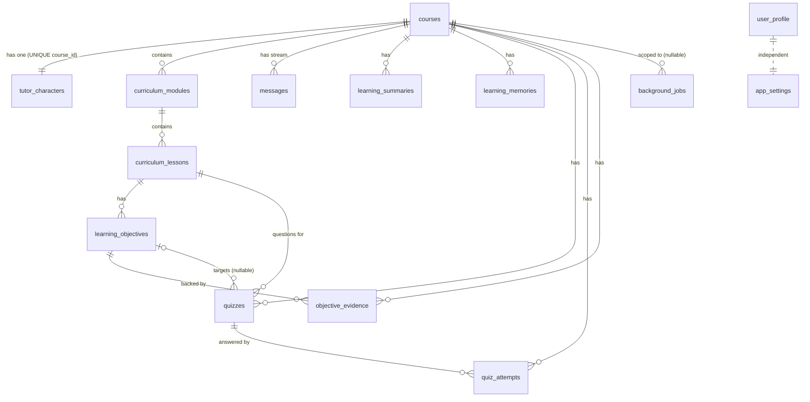

# DATA MODEL — Rhyme Tutor

> 상태 표기: **Implemented (1차 MVP)** · **Planned (2차 / 3차)** · **Deferred**
> 원천: `src/main/db/migrations.ts` (migration v1 `initial_schema`), `src/shared/domain.ts`. 두 파일이 다르면 migrations.ts가 DB의 진실이다.

## 1. 원칙

| 원칙 | 적용 |
|---|---|
| Local-first | 모든 학습 상태는 `<userData>/tutor.db` (SQLite) |
| 엔진 | `node:sqlite` `DatabaseSync` (Electron 45 번들 Node 24). 네이티브 모듈 없음 ([DECISIONS.md](DECISIONS.md) ADR-002) |
| 무결성 | `PRAGMA foreign_keys = ON`, `journal_mode = WAL`, CHECK 제약, UNIQUE, 트리거 |
| 마이그레이션 | 추가 전용(append-only). 배포된 버전 수정 금지. 각 버전은 트랜잭션, `schema_migrations`에 기록 |
| 시간 | 모든 시각은 ISO 8601 `TEXT` |
| 식별자 | 앱이 생성한 UUID `TEXT` PK |
| JSON 컬럼 | 구조가 고정적이지 않은 값만 `*_json` (`answers_json`, `choices_json`, `value_json`, `payload_json`, `voice_json`) |

## 2. 엔터티 매핑 (브리프 대비)

| 브리프 엔터티 | 1차 구현 | 상태 | 비고 |
|---|---|---|---|
| user_profiles | `user_profile` (싱글턴, `id = 1`) | Implemented (1차 MVP) | 이름 단수형 |
| onboarding_answers | `user_profile.answers_json`에 통합 | Implemented (1차 MVP) | 별도 테이블 불필요 |
| ai_providers | 테이블 없음. `app_settings.activeProvider` + 런타임 탐지 | Implemented (1차 MVP) | 탐지 결과는 저장하지 않음 |
| courses | `courses` | Implemented (1차 MVP) | |
| tutor_characters | `tutor_characters` | Implemented (1차 MVP) | 코스당 1명 |
| curriculum_modules | `curriculum_modules` | Implemented (1차 MVP) | |
| curriculum_lessons | `curriculum_lessons` | Implemented (1차 MVP) | |
| learning_objectives | `learning_objectives` | Implemented (1차 MVP) | |
| conversations | 별도 테이블 없음. 코스당 메시지 스트림 | Implemented (1차 MVP) | 주제 1개 = 대화 1개 |
| messages | `messages` | Implemented (1차 MVP) | |
| learning_memories | `learning_memories` | Implemented (1차 MVP) | |
| learning_sessions | 테이블 없음 | Deferred | 세션 개념은 `learning_summaries` 경계로 대체. 2차에서 필요 시 도입 |
| quiz_attempts | `quiz_attempts` (+ `quizzes`) | Implemented (1차 MVP) | 퀴즈 정의와 응답을 분리 |
| background_jobs | `background_jobs` | Implemented (1차 MVP) | |
| app_settings | `app_settings` (key/value JSON) | Implemented (1차 MVP) | |
| (추가) objective_evidence | `objective_evidence` | Implemented (1차 MVP) | 진도 근거 |
| (추가) learning_summaries | `learning_summaries` | Implemented (1차 MVP) | 세션 요약 |
| (추가) quizzes | `quizzes` | Implemented (1차 MVP) | 정답 키 보관 |
| assignments, assessments, reviews | 없음 | Planned (2차) | 2차 스키마에서 마이그레이션 v2 이후 추가 |
| knowledge sources / embeddings | 없음 | Deferred (3차) | |
| course clone / branch 관계 | 없음 | Deferred (3차) | `courses.parent_id` 등은 미정 |

## 3. ER 다이어그램

`user_profile`, `app_settings`는 코스와 관계가 없는 전역 테이블이다.

## 4. 테이블 명세 (migration v1)

### 4.1 `user_profile` — 학습 성향 (싱글턴)
| 컬럼 | 타입 | 제약 | 설명 |
|---|---|---|---|
| id | INTEGER | PK, CHECK `id = 1` | 한 행만 존재 |
| answers_json | TEXT | NOT NULL | `OnboardingAnswers` JSON |
| completed_at | TEXT | NOT NULL | 최초 완료 시각 |
| updated_at | TEXT | NOT NULL | 설정에서 수정 시 갱신 |

### 4.2 `app_settings` — 키/값 설정
| 컬럼 | 타입 | 제약 | 설명 |
|---|---|---|---|
| key | TEXT | PK | `theme`, `activeProvider`, `claudeModel`, `codexModel`, `requestTimeoutSec` 등 |
| value_json | TEXT | NOT NULL | JSON 값. 비밀 값은 저장하지 않음 |
| updated_at | TEXT | NOT NULL | |

### 4.3 `courses` — 학습 주제
| 컬럼 | 타입 | 제약 | 불변 | 설명 |
|---|---|---|---|---|
| id | TEXT | PK | ✔ | |
| request_id | TEXT | NOT NULL, UNIQUE | ✔ | 생성 멱등 키 (클라이언트 UUID) |
| title | TEXT | NOT NULL | ✔ | 주제명 |
| topic_prompt | TEXT | NOT NULL | ✔ | 자연어 원문 요청 |
| goal | TEXT | NOT NULL | | 학습 목표 |
| level | TEXT | CHECK beginner/intermediate/advanced | | 초기 숙련도 |
| pace | TEXT | CHECK slow/normal/fast | | 학습 속도 |
| curriculum_status | TEXT | DEFAULT `pending`, CHECK pending/generating/ready/failed | | 커리큘럼 *생성* 상태 |
| curriculum_error | TEXT | | | 실패 사유(사용자 표시용) |
| current_lesson_id | TEXT | | | 현재 단원 (FK 없음, 아래 4.13 참고) |
| created_at | TEXT | NOT NULL | ✔ | |
| updated_at | TEXT | NOT NULL | | |
| last_studied_at | TEXT | | | 대시보드 "최근 학습" |

트리거 `courses_immutable_identity`: `BEFORE UPDATE OF id, request_id, title, topic_prompt, created_at`에서 값이 바뀌면 `RAISE(ABORT, 'COURSE_IMMUTABLE')`.

### 4.4 `tutor_characters` — 선생님
| 컬럼 | 타입 | 제약 | 설명 |
|---|---|---|---|
| id | TEXT | PK | |
| course_id | TEXT | NOT NULL, UNIQUE, FK→courses ON DELETE CASCADE | 코스당 1명 |
| preset_id | TEXT | NOT NULL | `kind-explainer` 등 |
| name | TEXT | NOT NULL | 선생님 이름 |
| archetype, personality, speaking_style, teaching_style, expertise, approach, appearance | TEXT | NOT NULL | 구조화 캐릭터 정보 ([CHARACTER_SYSTEM.md](CHARACTER_SYSTEM.md)) |
| default_emotion | TEXT | NOT NULL | 기본 감정 |
| voice_json | TEXT | NULL | 3차 음성 설정 예약. MVP는 항상 NULL |
| prompt_version | TEXT | NOT NULL | 생성 당시 프롬프트 버전 |
| created_at | TEXT | NOT NULL | |

### 4.5 `curriculum_modules` — 모듈
| 컬럼 | 타입 | 제약 | 설명 |
|---|---|---|---|
| id | TEXT | PK | |
| course_id | TEXT | NOT NULL, FK ON DELETE CASCADE | |
| position | INTEGER | NOT NULL, UNIQUE(course_id, position) | 순서 |
| title, summary | TEXT | NOT NULL | |

### 4.6 `curriculum_lessons` — 단원
| 컬럼 | 타입 | 제약 | 설명 |
|---|---|---|---|
| id | TEXT | PK | |
| module_id | TEXT | NOT NULL, FK→curriculum_modules ON DELETE CASCADE | |
| course_id | TEXT | NOT NULL, FK→courses ON DELETE CASCADE | 비정규화: 코스 단위 조회·삭제용 |
| position | INTEGER | NOT NULL, UNIQUE(module_id, position) | |
| title, summary | TEXT | NOT NULL | |
| status | TEXT | DEFAULT `not_started`, CHECK not_started/in_progress/completed/needs_review | 단원 진도 |
| started_at, completed_at | TEXT | | |

인덱스: `idx_lessons_course(course_id)`.

### 4.7 `learning_objectives` — 학습 목표
| 컬럼 | 타입 | 제약 | 설명 |
|---|---|---|---|
| id | TEXT | PK | |
| lesson_id | TEXT | NOT NULL, FK→curriculum_lessons ON DELETE CASCADE | |
| course_id | TEXT | NOT NULL, FK→courses ON DELETE CASCADE | |
| position | INTEGER | NOT NULL, UNIQUE(lesson_id, position) | |
| description | TEXT | NOT NULL | 성취 기준 문장 |
| status | TEXT | DEFAULT `not_started`, CHECK not_started/in_progress/achieved/needs_review | |

인덱스: `idx_objectives_course(course_id)`.

### 4.8 `objective_evidence` — 진도 근거
| 컬럼 | 타입 | 제약 | 설명 |
|---|---|---|---|
| id | TEXT | PK | |
| objective_id | TEXT | NOT NULL, FK→learning_objectives ON DELETE CASCADE | |
| course_id | TEXT | NOT NULL, FK→courses ON DELETE CASCADE | |
| kind | TEXT | CHECK quiz/self_report | 근거 종류 |
| ref_id | TEXT | | kind=quiz이면 `quiz_attempts.id`, self_report이면 NULL |
| note | TEXT | NOT NULL | 사람이 읽는 근거 설명 |
| created_at | TEXT | NOT NULL | |

인덱스: `idx_evidence_objective(objective_id)`. 목표 상태를 `achieved`/`needs_review`로 바꾸는 모든 경로는 이 행을 같은 트랜잭션에서 삽입해야 한다 (규칙은 4.12 및 [LEARNING_SYSTEM.md](LEARNING_SYSTEM.md)).

### 4.9 `messages` — 코스별 대화 스트림
| 컬럼 | 타입 | 제약 | 설명 |
|---|---|---|---|
| id | TEXT | PK | |
| course_id | TEXT | NOT NULL, FK ON DELETE CASCADE | |
| lesson_id | TEXT | | 발생 단원. FK 없음 |
| role | TEXT | CHECK tutor/learner/system | |
| kind | TEXT | DEFAULT `chat`, CHECK chat/notice | `notice`는 스키마에만 있다. 1차 코드는 쓰지 않는다 (§6.4, Planned 2차) |
| content | TEXT | NOT NULL | 본문 (스트리밍 중에는 부분 본문) |
| status | TEXT | CHECK complete/streaming/error/cancelled | |
| client_message_id | TEXT | UNIQUE(course_id, client_message_id) | 학습자 메시지 멱등 키. 튜터 메시지는 NULL |
| reply_to | TEXT | | 응답 대상 학습자 메시지 id. FK 없음 |
| provider_id | TEXT | | 생성한 Provider (정보용, 맥락과 무관) |
| error_code | TEXT | | `AppErrorCode` |
| seq | INTEGER | NOT NULL, UNIQUE(course_id, seq) | 코스 내 순번. 정렬·요약 경계 |
| created_at, updated_at | TEXT | NOT NULL | |

인덱스: `idx_messages_course_seq(course_id, seq)`.

### 4.10 `quizzes` — 퀴즈 정의 (정답 키 포함)
| 컬럼 | 타입 | 제약 | 설명 |
|---|---|---|---|
| id | TEXT | PK | |
| course_id | TEXT | NOT NULL, FK ON DELETE CASCADE | |
| lesson_id | TEXT | NOT NULL, FK→curriculum_lessons ON DELETE CASCADE | |
| objective_id | TEXT | FK→learning_objectives ON DELETE SET NULL | 연결 목표 (없을 수 있음) |
| type | TEXT | CHECK multiple_choice/ox | |
| question | TEXT | NOT NULL | |
| choices_json | TEXT | NOT NULL | 객관식 보기, OX는 `["O","X"]` |
| answer_index | INTEGER | NOT NULL | **정답 키.** renderer에 응답 전에는 전달하지 않음 |
| explanation | TEXT | NOT NULL | 해설 |
| flagged | INTEGER | DEFAULT 0 | 신고 여부 (0/1) |
| flag_reason | TEXT | | 신고 사유 |
| provider_id | TEXT | | 생성 Provider |
| created_at | TEXT | NOT NULL | |

인덱스: `idx_quizzes_lesson(lesson_id)`.

### 4.11 `quiz_attempts` — 응답 기록
| 컬럼 | 타입 | 제약 | 설명 |
|---|---|---|---|
| id | TEXT | PK | |
| quiz_id | TEXT | NOT NULL, FK→quizzes ON DELETE CASCADE | |
| course_id | TEXT | NOT NULL, FK ON DELETE CASCADE | |
| selected_index | INTEGER | NOT NULL | 학습자 선택 |
| correct | INTEGER | NOT NULL | 저장된 `answer_index`와 비교한 결과 (0/1) |
| created_at | TEXT | NOT NULL | |

인덱스: `idx_attempts_quiz(quiz_id)`. 같은 퀴즈에 여러 번 응답 가능 (최신 응답이 `lastAttempt`).

### 4.12 `learning_summaries` — 세션 요약
| 컬럼 | 타입 | 제약 | 설명 |
|---|---|---|---|
| id | TEXT | PK | |
| course_id | TEXT | NOT NULL, FK ON DELETE CASCADE | |
| lesson_id | TEXT | | FK 없음 |
| summary | TEXT | NOT NULL | 요약 본문 |
| next_steps | TEXT | NOT NULL | 다음 학습 안내 |
| covered_until_message_id | TEXT | | 요약이 포함한 마지막 메시지 id. FK 없음 |
| covered_until_seq | INTEGER | NOT NULL | 요약 경계. 이후 메시지만 Context Builder가 전송 |
| created_at | TEXT | NOT NULL | |

인덱스: `idx_summaries_course(course_id, created_at)`.

### 4.13 `learning_memories` — 학습 기억
| 컬럼 | 타입 | 제약 | 설명 |
|---|---|---|---|
| id | TEXT | PK | |
| course_id | TEXT | NOT NULL, FK ON DELETE CASCADE | |
| kind | TEXT | CHECK strength/difficulty/note | |
| content | TEXT | NOT NULL | |
| confidence | TEXT | CHECK evidence/ai_inferred | `evidence` = 채점 데이터 기반, `ai_inferred` = AI 요약 판단 |
| source | TEXT | CHECK summary/quiz | |
| source_ref | TEXT | | 출처 id (요약 id 또는 attempt id) |
| created_at | TEXT | NOT NULL | |

인덱스: `idx_memories_course(course_id, created_at)`.

### 4.14 `background_jobs` — 작업 큐
| 컬럼 | 타입 | 제약 | 설명 |
|---|---|---|---|
| id | TEXT | PK | |
| type | TEXT | CHECK curriculum_generation/session_summary | 1차 작업 종류 |
| course_id | TEXT | FK ON DELETE CASCADE, NULL 허용 | |
| status | TEXT | CHECK queued/running/succeeded/failed/cancelled | |
| priority | INTEGER | DEFAULT 0 | 높을수록 먼저 |
| attempts | INTEGER | DEFAULT 0 | |
| max_attempts | INTEGER | DEFAULT 3 | |
| dedupe_key | TEXT | NULL 허용 | 활성 작업 중복 방지 키 |
| payload_json | TEXT | DEFAULT `'{}'` | 작업 입력 |
| error | TEXT | | 마지막 실패 메시지 |
| created_at, updated_at | TEXT | NOT NULL | |
| started_at, finished_at | TEXT | | |

인덱스: `idx_jobs_status(status, priority DESC, created_at)`, 부분 유니크 `uq_jobs_active_dedupe(dedupe_key) WHERE dedupe_key IS NOT NULL AND status IN ('queued','running')`.

### 4.15 참고: 알려진 FK 공백 (open item k: 1차에서 유지)
- `courses.current_lesson_id`, `messages.lesson_id`, `messages.reply_to`, `learning_summaries.lesson_id`, `learning_summaries.covered_until_message_id`는 FK가 없다. 이유는 마이그레이션 순서와 cascade 단순화.
- 결정 ([DECISIONS.md](DECISIONS.md) open item k): **1차에서는 FK를 추가하지 않는다.** 무효 참조는 서비스 계층 검사(`requireLesson`, 메시지 소속 확인 등)로 막는다. 2차 마이그레이션(새 version)에서 재검토한다. 기존 마이그레이션은 수정하지 않는다.

## 5. 관계와 삭제 정책

| 부모 | 자식 | 정책 | 근거 |
|---|---|---|---|
| courses | tutor_characters, curriculum_*, learning_objectives, objective_evidence, messages, quizzes, quiz_attempts, learning_summaries, learning_memories, background_jobs | **ON DELETE CASCADE** | 주제 삭제 시 학습 데이터 전체 제거 |
| curriculum_modules | curriculum_lessons | CASCADE | |
| curriculum_lessons | learning_objectives, quizzes | CASCADE | |
| learning_objectives | quizzes.objective_id | **SET NULL** | 퀴즈는 남기고 목표 연결만 끊음 |
| learning_objectives | objective_evidence | CASCADE | |
| quizzes | quiz_attempts | CASCADE | |
| user_profile, app_settings | — | 독립 | 주제 삭제와 무관 |

**삭제 절차 규칙**
- 주제 삭제는 확인 대화상자 후 `courses.delete`만 호출한다. 실행 중인 작업이나 채팅이 있으면 먼저 취소하고, 해당 코스의 `queued`/`running` 작업은 cascade로 함께 제거된다.
- 삭제는 되돌릴 수 없다. 삭제 전 내보내기는 사용자 선택 사항.
- 선생님 단독 삭제·재생성 API는 없다. 주제 삭제가 유일한 경로.

## 6. 상태 모델

### 6.1 코스 커리큘럼 상태 (`courses.curriculum_status`)
`pending` → `generating` → `ready` | `failed`. `failed` → `generating` (재시도, `courses.retryCurriculum`).

### 6.2 단원 상태 (`curriculum_lessons.status`)
| 전이 | 트리거 | 근거 |
|---|---|---|
| not_started → in_progress | `lessons:select` (`selectLesson`), `chat:send`, `chat:startLesson` (`recordStudyActivity`, 같은 트랜잭션) | 사용자 행동 |
| any → completed | `lessons:complete` (`completeLesson`, 명시적 완료). 다음 미완료 단원을 현재 단원으로 지정 | 사용자 행동 |

- `chat:send`/`chat:startLesson`은 `not_started`만 `in_progress`로 바꾼다. `in_progress`, `completed`, `needs_review` 상태는 바꾸지 않는다.
- AI 응답만으로는 단원 상태를 바꾸지 않는다.
- **Planned / 코드 미확인**: "퀴즈 오답으로 목표가 `needs_review`가 되면 단원도 `needs_review`" 같은 자동 전이는 현재 `LearningService`에 없다. 단원 `needs_review`는 저장 값으로만 존재한다.

### 6.3 목표 상태 (`learning_objectives.status`)
| 전이 | 필수 근거 (코드: `LearningService.answerQuiz`, `selfCheck`) |
|---|---|
| not_started/in_progress/needs_review → achieved | 연결된 퀴즈 정답 (`kind=quiz`) 또는 학습자 "이해했어요" (`kind=self_report`) |
| not_started/in_progress → needs_review | 연결된 퀴즈 오답 (`kind=quiz`) 또는 "다시 볼게요" (`kind=self_report`) |
| achieved → (퀴즈 오답) | 변경 없음 (`achieved` 유지, 근거 행 없음) |
| needs_review → (퀴즈 오답) | 변경 없음 |
| 전이 없음 | 정답 근거는 `achieved`인 목표에는 추가하지 않는다 |
| not_started → in_progress | 코드에서 목표를 `in_progress`로 바꾸는 경로를 확인하지 못함 (Unverified). 근거 행 없음 |

**불변 규칙**: `achieved` 또는 `needs_review`로 바뀌는 모든 전이는 같은 트랜잭션에서 `objective_evidence`를 삽입한다 (`setObjectiveWithEvidence`). 근거 행 없이 목표 상태를 바꾸는 저장소 함수는 없다.

### 6.4 메시지 상태 (`messages.status`)
`streaming` → `complete` | `error` | `cancelled`. `error`/`cancelled` → `streaming` (재시도, 같은 행). 앱 시작 시 남아 있는 `streaming`은 `error`(`error_code = PROVIDER_FAILED`)로 정리한다. 본문이 비어 있으면 고정 문구를 넣고, 본문이 있으면 그대로 둔다. **`notice` 행은 추가하지 않는다** (`recoverStreamingMessages`, Planned 2차). 자세한 내용은 [TUTOR_ENGINE.md](TUTOR_ENGINE.md) §3.2.

### 6.5 작업 상태 (`background_jobs.status`)
[BACKGROUND_JOBS.md](BACKGROUND_JOBS.md) 6절 참고.

## 7. 무결성 장치

| 장치 | 대상 | 목적 |
|---|---|---|
| 트리거 `courses_immutable_identity` | courses | 주제 식별자·원문 불변 (DB 경계) |
| `request_id UNIQUE` | courses | 주제 생성 멱등 |
| `UNIQUE(course_id, client_message_id)` | messages | 학습자 메시지 중복 저장 방지 |
| `UNIQUE(course_id, seq)` | messages | 순서 충돌 방지 |
| `UNIQUE(course_id)` | tutor_characters | 코스당 선생님 1명 |
| `UNIQUE(course_id, position)`, `UNIQUE(module_id, position)`, `UNIQUE(lesson_id, position)` | 커리큘럼 | 재생성 시 중복 순서 방지 |
| 부분 유니크 `uq_jobs_active_dedupe` | background_jobs | 같은 키의 활성 작업은 하나 |
| CHECK 제약 | 모든 enum 컬럼 | 잘못된 상태값 거부 |
| 트랜잭션 | 코스 생성, 커리큘럼 저장, 메시지 전이, 채점+근거 | 부분 저장 방지 |

**중요**: 불변성은 UI에서만 제한하지 않는다. (1) Zod 스키마에서 필드 자체를 제외하고, (2) 저장소가 수정 시도를 거부하고, (3) 트리거가 최종 방어선이다.

## 8. 인덱스 요약

| 인덱스 | 용도 |
|---|---|
| idx_lessons_course | 코스별 단원 목록 |
| idx_objectives_course | 코스별 목표 |
| idx_evidence_objective | 목표 근거 조회 |
| idx_messages_course_seq | 대화 페이지네이션 (before seq) |
| idx_quizzes_lesson | 단원별 퀴즈 |
| idx_attempts_quiz | 퀴즈별 응답 |
| idx_summaries_course | 최신 요약 조회 |
| idx_memories_course | 최근 기억 (≤10개) |
| idx_jobs_status | 큐 polling (상태, 우선순위 DESC, 생성 시각) |
| uq_jobs_active_dedupe | 활성 작업 중복 방지 |

## 9. 멱등 키 정리

| 연산 | 키 | 중복 시 동작 |
|---|---|---|
| 주제 생성 | `courses.request_id` (클라이언트 UUID) | 기존 코스 반환, 새 레코드 없음 |
| 학습자 메시지 저장 | `messages(course_id, client_message_id)` | 기존 메시지 반환 |
| 튜터 응답 재시도 | 메시지 `id` | 같은 행 재사용 (새 행 없음) |
| 커리큘럼 작업 등록 | `background_jobs.dedupe_key` = `curriculum:<courseId>` (`jobKeys.curriculum`) | 활성 작업 있으면 기존 작업 반환 |
| 요약 작업 등록 | `dedupe_key` = `summary:<courseId>` (`jobKeys.summary`) | 동일 |

키 형식은 `src/main/learning/service.ts`의 `jobKeys`가 원천이다. 과거 문서의 `session_summary:<courseId>` 형식은 사용하지 않는다.

## 10. 데이터 보존과 내보내기

| 항목 | 정책 |
|---|---|
| 대화·퀴즈·진도 | 주제 삭제 전까지 영구 보존. 앱 재시작 후 100% 복원이 목표 |
| 작업 기록 | 완료·실패 작업 행은 유지 (상태 확인용). 자동 정리는 2차 |
| 로그 | 프롬프트·응답 본문 미기록 ([SECURITY.md](SECURITY.md)) |
| 내보내기 | 학습 데이터 JSON 덤프, 저장 대화상자는 main에서 연다 (Implemented 1차). 가져오기는 Deferred. 내보내기 파일에는 학습자 내용이 들어 있어 민감 정보로 취급한다 ([SECURITY.md](SECURITY.md)) |
| 백업 | 기존 스키마가 있고 대기 중 마이그레이션이 있을 때 마이그레이션 전 DB 파일을 `tutor.db.bak-<fromVersion>`으로 복사 (Implemented, `connection.ts`). 새 DB는 백업하지 않는다 |
| 암호화 | 저장 시 암호화 없음 (Deferred). 파일 권한과 OS 사용자 계정에 의존 |

## 11. DB 변경 전략

1. 새 기능은 `MIGRATIONS` 배열 끝에 새 `version`을 추가한다. 기존 항목 수정 금지.
2. 마이그레이션 실패 시 트랜잭션 롤백, 앱은 오류 화면을 보여주고 반쯤 마이그레이션된 DB로 시작하지 않는다.
3. 파괴적 변경(컬럼 삭제, 타입 변경)은 새 테이블 생성 → 복사 → 교체 순서로 작성한다.
4. 모든 마이그레이션은 빈 DB와 기존 DB 양쪽에서 테스트한다 ([TEST_PLAN.md](TEST_PLAN.md)).
5. 2차 예정 변경: 과제·평가·복습 테이블, `learning_sessions` 도입 여부 결정, FK 공백 보강.

## 12. 확인 필요 사항 (스키마 vs 계약)

| 항목 | 내용 | 권장 |
|---|---|---|
| `learning_summaries.covered_until_seq` | DB에는 있고 서비스 내부에서 쓰지만, 공개 `LearningSummary` 타입에는 없다 (`coveredUntilMessageId`만 노출) | DECISIONS open item e: 1차에 공개 계약을 바꾸지 않는다. 변경은 leader 승인 필요 |
| `learning_memories.source` | `summary`/`quiz`만 허용. 자기보고 기반 기억을 만들 출처가 없다 | DECISIONS open item j: 1차에서는 `self_report`를 기억으로 쓰지 않는다. 2차에서 leader 승인 후 검토 |
| `messages.lesson_id`, `courses.current_lesson_id` 등 FK 없음 | §4.15 | DECISIONS open item k: 1차 유지, 서비스 계층 검사 |
| 메시지 `kind = notice` | 스키마에는 있으나 1차 코드가 쓰지 않는다 | 2차 Planned |
| 목표 `not_started → in_progress` 경로 | §6.3 | 코드 경로 확인 필요 (Unverified) |

Open item l (멱등 키 형식): 구현 확정 (`curriculum:<courseId>`, `summary:<courseId>`, §9). 원 항목은 [DECISIONS.md](DECISIONS.md)에서 Resolved로 표시했다.
