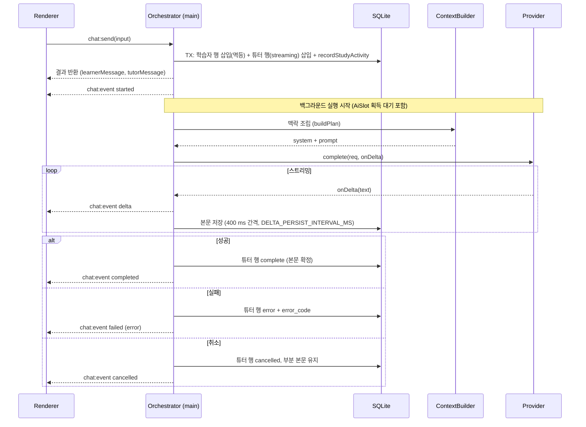

# TUTOR ENGINE — 수업 채팅, 맥락, 요약

> 상태 표기: **Implemented (1차 MVP)** · **Planned (2차 / 3차)** · **Deferred** · **Unverified** (1차 목표로 적었으나 src/에서 동작을 확인하지 못함)
> 구조 원천: ARCHITECTURE §4–§6. 메시지 상태: [DATA_MODEL.md](DATA_MODEL.md) 6.4. 확인 기준: `src/main/tutor/*`, `src/main/db/repo-*.ts`, `src/shared/ipc.ts`, `src/shared/domain.ts`.

## 1. 역할

Tutor Engine은 학습자의 메시지를 받아 **선생님 응답을 생성하고, 학습 상태를 갱신하는 오케스트레이터**다. Renderer는 IPC로 요청만 보내고, 실제 조립·호출·저장은 메인 프로세스가 수행한다.

| 책임 | 상태 |
|---|---|
| 수업 메시지 저장과 스트리밍 응답 | Implemented (1차 MVP) |
| 취소, 재시도(같은 행 재실행), 대화 복원 (페이지 조회) | Implemented (1차 MVP) |
| 수업 시작 (`chat:startLesson`) | Implemented (1차 MVP) |
| 단원 설명, 이해 확인, 다음 단원 제안 | 프롬프트 지시 수준 Implemented. 실제 응답 품질은 CLI 기준 수동 확인 대상 |
| 맥락 조립 (Context Builder) | Implemented (1차 MVP) |
| 세션 요약과 기억 생성 (백그라운드, 단원 완료 시) | Implemented (1차 MVP) |
| 앱 재실행 후 자동 재개 메시지와 "이어서 수업하기" 버튼 | Verified (E2E, §8) |
| 적응형 난이도 조정 | Planned (2차) |
| 음성 입출력 | Planned (3차) |

## 2. 코스당 활성 대화 1개 (BUSY 규칙)

- 한 코스에서 동시에 진행되는 튜터 응답은 **하나**다. 판정은 메모리 맵(진행 중 응답)과 DB의 `streaming` 행을 함께 본다 (`TutorOrchestrator.isBusy`).
- 응답 진행 중 같은 코스에 `chat:send`, `chat:startLesson`, `chat:retry`를 보내면 `BUSY` 오류를 반환한다. 메시지 `"튜터가 아직 답변하고 있어요. 잠시 후 다시 시도해 주세요."`. 새 행은 만들지 않는다.
- 다른 코스의 대화는 독립적으로 **시작**할 수 있다. 다만 AI 호출 자체는 전역 `AiSlot`(동시성 1)을 공유하므로, 다른 코스 응답은 슬롯을 얻을 때까지 `started` 상태로 대기한다. 우선순위와 선점은 없다 (→ [BACKGROUND_JOBS.md](BACKGROUND_JOBS.md)).

## 3. 채팅 흐름

`chat:send`는 행을 저장하는 즉시 반환하고, 응답은 백그라운드에서 이어진다. 완료 여부는 `chat:event`로만 알 수 있다.

### 3.1 단계별 규칙

| 단계 | 규칙 |
|---|---|
| 학습자 메시지 저장 | `UNIQUE(course_id, client_message_id)`로 멱등. 같은 ID 재전송이면 기존 학습자 행과 그에 대한 튜터 행을 반환하고 새 응답을 시작하지 않는다 |
| 튜터 메시지 생성 | 같은 TX에서 `status = streaming`인 행 삽입 (`reply_to` = 학습자 행) |
| 학습 활동 기록 | 같은 TX에서 `recordStudyActivity`: 코스 `last_studied_at`·`updated_at` 갱신, 현재 단원이 `not_started`면 `in_progress`로 변경(`started_at` 설정). 완료·검토 필요 상태는 바꾸지 않는다. 목표 상태는 바꾸지 않는다 (§3.2) |
| 스트리밍 | `onDelta`마다 `chat:event delta` 전송. DB 본문 저장은 400 ms 간격과 완료 시점 |
| 완료 | 본문과 `status = complete`를 갱신하고 `chat:event completed`. 요약 작업은 큐잉하지 **않는다** (요약은 단원 완료 시에만, §7) |
| 실패 | 학습자 메시지는 보존. 튜터 행은 `error` + `error_code`. 자동 재시도는 하지 않으며 사용자가 재시도한다 |
| 취소 | 사용자가 취소하면 AbortSignal → 행 `cancelled`, 그때까지의 부분 본문 유지. 슬롯 대기 중 취소도 `cancelled`로 끝난다 |
| 재시도 | 같은 튜터 행을 `streaming`으로 되돌려 재호출 (`resetMessageForRetry`). 새 행을 만들지 않는다. `error`와 `cancelled` 행에만 허용 |
| 학습 활동 (수업 시작) | `chat:startLesson`도 같은 규칙으로 `recordStudyActivity`를 호출하며 학습자 행은 만들지 않는다 |

### 3.2 앱 재시작 복구

시작 시 `status = streaming`인 튜터 메시지는 `error`(`error_code = PROVIDER_FAILED`)로 바뀐다. 본문이 비어 있으면 `"앱이 종료되어 응답이 중단되었어요"`를 본문으로 넣고, 본문이 있으면 그대로 둔다 (`recoverStreamingMessages`).

- 학습자 메시지는 그대로 남는다. 사용자는 재시도 버튼으로 이어갈 수 있다.
- **`notice` 메시지 행은 쓰지 않는다.** 1차 구현에 해당 경로가 없다. 복구 건수는 로그에 남는다.
- 이전 설계의 "재시작 중단 안내 `notice` 행"은 **Planned**로 본다 (`MessageKind`에 `notice`는 있으나 현재 쓰는 코드가 없다).

## 4. 수업 진행 패턴

선생님은 학습자의 질문을 기다리기만 하지 않고 **다음 행동을 제안**한다. 아래 표의 행동은 프롬프트 지시로 구현되며, 실제 응답 품질은 CLI로 수동 확인한다.

| 의도 | 트리거 | 선생님 동작 | 상태 |
|---|---|---|---|
| 수업 시작 | `chat:startLesson` (수업 시작 동작) | 인사 → 단원 목표 소개 → 첫 개념 설명 (`LESSON_START_INSTRUCTION`) | Implemented |
| 설명 | 학습자 메시지 (`chat:send`) | 프로필(성향·캐릭터) 기반 설명, 예시 1개 (`EXPLANATION_SKILL`) | Implemented |
| 이해 확인 | 설명 직후 | 질문 1개 또는 퀴즈 제안 | 프롬프트 지시 (Unverified: 실제 제안 빈도) |
| 퀴즈 제안 | 목표 1개 이상 다룸 | "퀴즈 풀어 볼까요?" → 퀴즈 생성(`quiz:generate`) | 프롬프트 지시 (Unverified) |
| 단원 완료 제안 | 학습자가 이해 표시 | "이 단원을 완료로 표시할까요?" → 사용자가 `lessons:complete`로 확정 | Implemented (버튼 확정) |
| 다음 단원 | 완료 후 | 다음 단원 소개 제안 (자동 전환하지 않음) | Implemented (`nextOpenLessonId` 기준) |
| 재개 | 앱 재실행 후 첫 진입 | 지난 요약 한 줄 + 현재 단원 이어서 제안 | Unverified (§8) |

**금지**: AI가 `lessons.complete`나 목표 `achieved`를 직접 실행하지 않는다. AI 응답은 제안까지만 하며, 상태 변경은 사용자 행동 또는 채점 결과에서만 발생한다 ([LEARNING_SYSTEM.md](LEARNING_SYSTEM.md)).

## 5. Context Builder

채팅마다 전체 기록을 보내지 않는다. 다음 순서로 예산 안에서 조립한다.

| 우선순위 | 항목 | 규칙 |
|---|---|---|
| 1 | 최신 요약 | `learning_summaries` 최신 1개 (`covered_until_seq` 이후 메시지만 대화에 포함) |
| 2 | 학습 기억 | 최대 10개(`MAX_MEMORIES`). `evidence` 우선, 그다음 최신순 (`ai_inferred`) |
| 3 | 현재 단원과 목표 | `courses.current_lesson_id` 기준 단원 제목·요약, 목표 목록과 상태 |
| 4 | 퀴즈 통계 | 현재 단원의 퀴즈별 최신 시도 기준 정답 수, 오답 목표 목록 |
| 5 | 최근 메시지 | `covered_until_seq` 이후, `status = complete`인 학습자·선생님 메시지 최대 40개(`CHAT_HISTORY_WINDOW`). 진행 중·실패·취소 행은 제외. 현재 보내는 학습자 메시지와 그 이후 행은 제외 |

- **예산**: `CONTEXT_BUDGET_CHARS = 12,000`자 (system + prompt 합계).
- **줄이는 순서**: 5 (오래된 메시지부터 한 개씩 제거, 가장 최신 메시지는 유지) → 4 (퀴즈 통계 전체 제거) → 3 (목표는 최소 1개까지) → 2 (기억 전체 제거). **1번(최신 요약)은 줄이지 않는다.** 1번과 나머지를 모두 줄여도 예산을 넘으면 그대로 보낸다.
- **긴 메시지**: 1,500자(`MAX_MESSAGE_CHARS`)를 넘으면 **앞부분을 자르고 뒷부분을 남기며** `…(중략) ` 표시를 붙인다. 학습자 메시지도 같은 규칙을 따른다.
- 조립 결과는 `system`(PromptBuilder 섹션)과 `prompt`(퀴즈 통계 + 최근 대화 + 학습자 메시지)로 분리한다. 줄인 항목 이름은 로그(`context trimmed`)에 남는다.

### 5.1 예산 설정
예산과 항목 상한은 상수로 두며 설정 화면에 노출하지 않는다. 변경 시 이 문서와 테스트를 함께 갱신한다.

## 6. PromptBuilder

`buildCoreSystem`이 아래 입력을 받아 system 문자열을 만든다. 블록 이름과 문구의 원천은 `src/main/tutor/prompts.ts`다.

| 섹션 | 내용 | 출처 |
|---|---|---|
| `core` | 역할, 안전 규칙, 출력 형식 공통 규칙 | 상수 |
| `character` | 이름, 성격, 말투, 교수법 | `tutor_characters` |
| `learner` | 온보딩 성향 요약 | `user_profile` |
| `course` | 주제 제목, 학습 목표, 수준, 페이스 | `courses` (불변 식별자 + 수정 가능 필드) |
| `lesson` | 현재 단원 정보와 목표 목록·상태 | `curriculum_lessons`, `learning_objectives` |
| `summary` | 최신 요약 | `learning_summaries` |
| `memory` | 학습 기억 블록 | Context Builder |
| `skill` | 활성 Skill의 작업 지시 (설명, 수업 시작, 퀴즈 등) | Skill 지시 상수 |

- `tutor_characters.prompt_version` 컬럼에 캐릭터 생성 시점의 버전 문자열을 저장한다 (`insertTutor`). 버전 상수의 출처는 `prompts.ts`.
- 학습자 텍스트는 `prompt`에만 들어가며 `core`나 `character`에 섞지 않는다 (프롬프트 주입 완화).
- 시스템 지시에 "근거가 없으면 모른다고 말하고 정답을 임의로 확정하지 말 것"을 포함하는 것이 설계 목표다. 문구는 `prompts.ts`가 기준이다.

## 7. 세션 요약 (`session_summary`)

| 항목 | 내용 |
|---|---|
| 트리거 | **단원 완료 시에만** (`lessons:complete`). 마지막 요약의 `covered_until_seq` 이후 완료 메시지가 있을 때 큐잉. 메시지 개수 기반 자동 트리거는 **없다** (이전 "약 12개마다" 규칙은 폐기) |
| 실행 | 백그라운드 작업 (`session_summary`), 전역 `AiSlot` 공유 (동시성 1, 우선순위 없음) |
| 입력 | 마지막 요약 이후 메시지 + 최근 퀴즈 결과 |
| 출력 | `AiSessionSummarySchema`로 검증된 JSON: 요약, 강점, 어려움, 다음 학습 (구조화 출력, 최대 재시도 2회 후 `INVALID_AI_OUTPUT`) |
| 저장 | `learning_summaries` 1행 (`covered_until_seq` 기록) + `learning_memories` 여러 행 |
| 기억 신뢰도 | 퀴즈 기반이면 `evidence`(`source = quiz`), 요약 AI 판단이면 `ai_inferred`(`source = summary`) |
| 실패 | 재시도 가능한 오류는 백오프 후 재시도 (최대 3회). 최종 실패 시 요약 없이 끝나며 대화는 막지 않는다 |

요약 작업은 **진도를 바꾸지 않는다**. 기억과 요약만 쓴다. `self_report`는 기억의 `source`로 쓰지 않는다 (DECISIONS open item j).

## 8. 재시작 후 복원 ("다음 날 학습 재개")

| 단계 | 동작 | 상태 |
|---|---|---|
| 1 | 대시보드 코스 목록 | `courses:list`는 `created_at` 내림차순을 반환한다. `last_studied_at` 기준 정렬은 renderer 구현을 확인해야 한다 — Unverified |
| 2 | "이어서 수업하기" 버튼 | Verified (E2E 시나리오 D) |
| 3 | 교실 진입: 스냅샷 최근 메시지 페이지 로드 | Implemented (`classroom:get`, `chat:history`는 `beforeMessageId` 기준 역방향 페이지) |
| 4 | 선생님이 최신 요약 한 줄과 현재 단원으로 재개 메시지 제안 | Unverified (자동 재개 메시지 경로를 src에서 확인하지 못함) |
| 5 | 학습자가 답하면 기존 흐름과 동일 | Implemented |

재개에 필요한 데이터(`current_lesson_id`, `last_studied_at`, 최신 요약)는 저장되어 있다. 위 2·4단계의 UI·프롬프트 동작은 확인 후 상태를 갱신한다.

## 9. IPC와 이벤트

채널 이름 원천은 `src/shared/ipc.ts`(`IPC`, `EVENTS`)다.

| 채널 | 방향 | 용도 |
|---|---|---|
| `chat:history` | Renderer → Main | 페이지 단위 메시지 조회 (`courseId`, `beforeMessageId`, `limit`) |
| `chat:send` | Renderer → Main | 학습자 메시지 전송 (멱등 `clientMessageId`) |
| `chat:startLesson` | Renderer → Main | 튜터가 학습자 입력 없이 현재 단원 시작 |
| `chat:cancel` | Renderer → Main | 코스의 진행 중 응답 취소 |
| `chat:retry` | Renderer → Main | 실패·취소된 튜터 메시지 같은 행에서 재시도 |
| `chat:event` | Main → Renderer | `ChatStreamEvent` 푸시 (아래 type) |

`chat:event`의 `type`은 `started`, `delta`, `completed`, `failed`, `cancelled` 다섯 가지다 (`src/shared/domain.ts`의 `ChatStreamEvent`). `failed`에는 `AppErrorPayload`가 함께 온다.

모든 invoke 응답은 `Result<T>` 봉투로 반환하며 IPC는 예외를 던지지 않는다.

## 10. 실패와 사용자 경험

| 상황 | 사용자가 보는 것 | 데이터 상태 |
|---|---|---|
| 응답 스트리밍 중 취소 | 부분 응답 (표시 문구는 renderer 확인 필요) | 튜터 행 `cancelled`, 부분 본문 유지, `error_code = PROVIDER_CANCELLED` |
| CLI 인증 만료 (`PROVIDER_AUTH_REQUIRED`) | 인증 안내 | 튜터 행 `error`, 학습자 메시지 보존, 재시도 불가 |
| 재시도 가능한 CLI 오류 (`PROVIDER_TIMEOUT`, `PROVIDER_FAILED`, `PROVIDER_RATE_LIMITED`) | 오류 안내 + 재시도 | 튜터 행 `error`, `retryable = true` |
| 앱 강제 종료 중 응답 | 재실행 시 복구 안내 표시 여부는 Unverified (재시도 버튼으로 이어갈 수 있다) | 튜터 행 `error`, `PROVIDER_FAILED`, `notice` 행 없음 (§3.2) |
| 같은 코스 응답 진행 중 새 요청 | `"튜터가 아직 답변하고 있어요. 잠시 후 다시 시도해 주세요."` (`BUSY`) | 새 행 없음 |
| 알 수 없는 내부 오류 | `"알 수 없는 오류가 발생했어요."` (`UNKNOWN`) | 튜터 행 `error` |

채팅 경로는 자유 텍스트 응답이라 `INVALID_AI_OUTPUT`이 나지 않는다. 구조화 출력 실패(`INVALID_AI_OUTPUT`, 문구 `"AI 응답 형식이 맞지 않아요."`)는 퀴즈 생성·요약·커리큘럼 작업의 오류다 ([BACKGROUND_JOBS.md](BACKGROUND_JOBS.md), [LEARNING_SYSTEM.md](LEARNING_SYSTEM.md)).

## 11. 2차 / 3차 예정

| 항목 | 단계 | 상태 |
|---|---|---|
| 학습자 답변 기반 적응형 설명 깊이 | 2차 | Planned (2차) |
| 과제 제출 메시지 처리 | 2차 | Planned (2차) |
| `notice` 메시지 행 기록 (재시작 중단 안내 등) | 2차 | Planned (2차) |
| 음성 대화 (STT/TTS) | 3차 | Planned (3차) |
| 다중 세션 (세션 단위 분리) | 3차 | Deferred |
